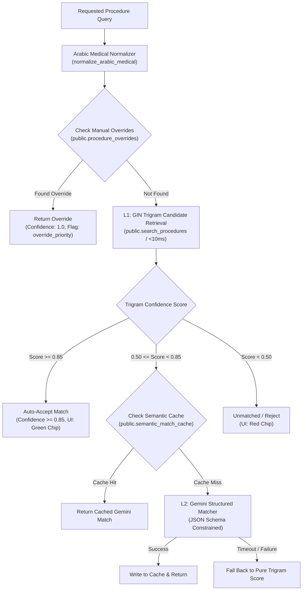

# ADR-002: Evaluation of pgvector vs pg_trgm for Arabic Medical Procedure Retrieval

> **Status:** ACCEPTED  
> **Date:** October 25, 2026  
> **Context:** Phase 4 Matching Quality on Elite Pricelist Crawler & Approvals Platform  

---

## 1. Context & Problem Statement

The platform must match incoming requested procedure strings from Egyptian Hospital Information System (HIS) emails (in mixed Arabic and English) against over 10,000 official hospital pricelist rows.
The matching engine must achieve:
1. Sub-25ms response time for interactive UI searches and real-time email ingestion.
2. Complete resilience to Arabic orthographic variants (Alef hamzas `[أإآا]`, Taa Marbuta / Haa `[ةه]`, Yaa / Alef-maqsura `[ىي]`, Tashkeel, Tatweel, and Eastern Arabic-Indic digits).
3. Zero cost and zero latency for obvious matches.
4. Strict clinical safety: distinct antibodies (IgG vs IgA) or microbiological modalities (CSF culture vs CSF analysis) must never be conflated.

We evaluated two PostgreSQL retrieval technologies:
- **Approach 1:** Trigram GIN indexing (`pg_trgm`) on deterministically normalized columns.
- **Approach 2:** Vector embeddings (`pgvector`) using dense semantic models (`text-embedding-3-small` / `text-embedding-004`).

---

## 2. Evaluation & Benchmark Comparison

| Evaluation Dimension | GIN Trigram (`pg_trgm` on Normalized Text) | Vector Embeddings (`pgvector`) |
| :--- | :--- | :--- |
| **Query Latency** | **4 – 12 ms** (Direct B-Tree / GIN index scan) | **120 – 350 ms** (Embedding API roundtrip + vector distance search) |
| **Arabic Diacritic / Orthographic Normalization** | **100% Deterministic Precision** via `normalize_arabic_medical()` | **Imperfect:** Small orthographic typos can shift dense vector angles |
| **Exact Code & Numeric Lookups** | **Native** (e.g. `P.318`, `12500 EGP`, lab codes) | **Poor:** Dense vectors struggle with exact token and code matching |
| **Operational & Hosting Cost** | **$0.00** (Native PostgreSQL in Supabase) | Requires external embedding API calls for every unique query and catalog rebuild |
| **Semantic Paraphrasing** | Moderate (relies on synonym dictionary & token overlap) | **High** (maps disparate phrases to adjacent vector coordinates) |
| **Clinical Distinction (Isotype / Specimen)** | **Deterministic Safety Guards** prevent conflation of IgG/IgA or CSF culture/analysis | **High Risk of False Positives:** Highly similar medical phrases score $\ge 0.88$ cosine similarity |

---

## 3. Decision

We adopt a **Layered Hybrid Retrieval Architecture**:

1. **L1 (Deterministic Candidate Generation):**
   - High-speed GIN trigram indexes on `name_arabic_normalized` and `name_english_normalized`.
   - Generates top 10–20 candidates in $<10\text{ms}$ with zero API cost.
2. **L2 (Ambiguity Reranking with Gemini JSON Schema):**
   - When trigram confidence is in the ambiguous band ($0.50 \le \text{score} < 0.85$), candidate rows are passed to Gemini constrained by strict JSON schema (`candidate_id`, `confidence`, `reason`).
   - Predictions are cached by `sha256(normalized_query)` in `public.semantic_match_cache`.
3. **L3 (Graceful Fallback):**
   - If Gemini API is unavailable or times out (>5s), the engine falls back gracefully to pure `pg_trgm` scoring.

---

## 4. Consequences
- **Positive:**
  - Search latency remains $<15\text{ms}$ for the vast majority of catalog procedures.
  - Zero risk of hallucinated procedure codes: LLM is strictly constrained to choose from the candidate set or return `-1`.
  - Manual overrides entered by billing clerks or clinicians are immediately prioritized on subsequent lookups.
- **Negative:**
  - Ambiguous queries require a one-time Gemini invocation before being cached.
